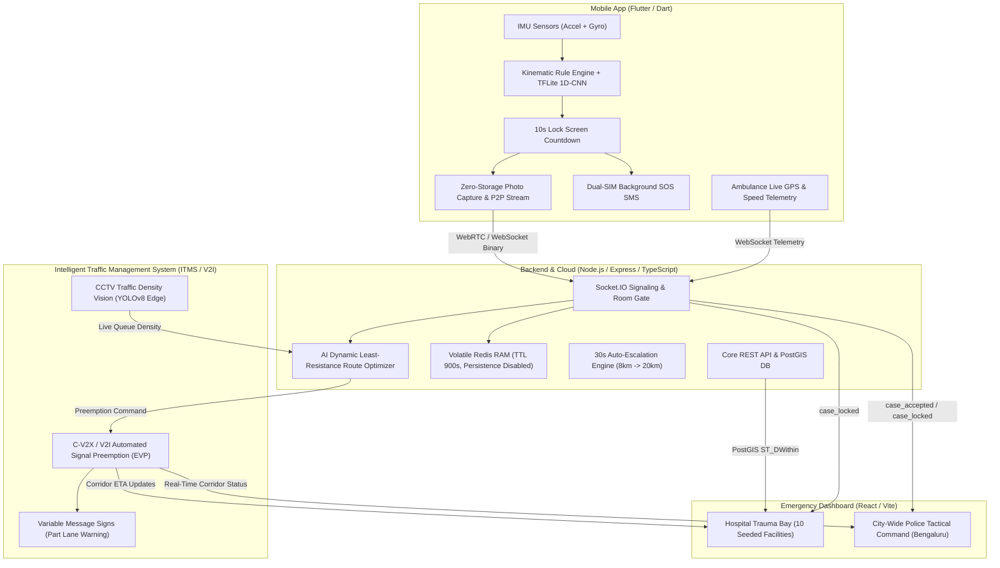
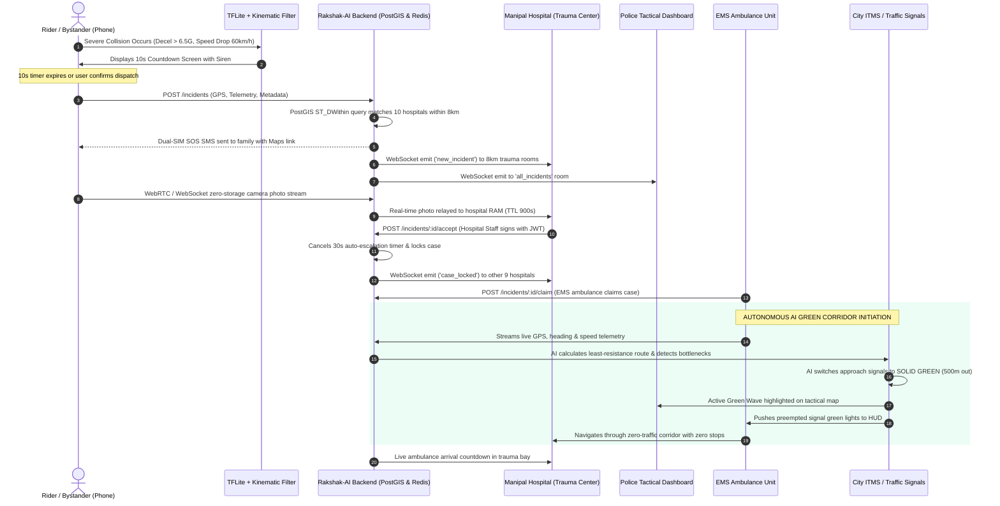

# RAKSHAK-AI: SYSTEM ARCHITECTURE, UI DESIGN SPECIFICATION & AI VIDEO GENERATION BLUEPRINT
## Including Autonomous AI Green Corridor & Dynamic Traffic Signal Preemption (V2I / C-V2X)

---

## 1. EXECUTIVE SYSTEM OVERVIEW & CORE MISSION

**Rakshak-AI** is an autonomous, ultra-low-latency emergency crash detection, zero-storage photographic triage, distributed trauma hospital dispatch, and **AI-powered autonomous Green Corridor traffic grid ecosystem**. Designed specifically for India's high-density traffic environments (starting with Bengaluru), it solves the critical **"Golden Hour"** delay between vehicular impact and definitive medical care.

### The Problem It Solves
- **82% of fatal road collisions** in Indian urban centers suffer from delayed bystander reporting or misdirected hospital transport.
- **Urban Congestion Paralysis**: In cities like Bengaluru, ambulances are routinely trapped in stationary traffic gridlock at choke points (e.g., Silk Board, Tin Factory, 100ft Road), losing $15-35$ vital minutes of the Golden Hour.
- Victims frequently arrive at secondary clinics lacking Level-1 trauma surgical facilities or ICU beds, necessitating chaotic inter-hospital transfers.
- Bystanders hesitate to report crashes due to privacy fears, police harassment concerns, and personal data leakage.

### The Rakshak-AI Solution
1. **Instant Autonomous Detection**: Mobile IMU sensors detect collision kinematic signatures ($>6.5\text{G}$ deceleration + acute speed drop) with on-device TensorFlow Lite ML verification.
2. **Deterministic Fallback**: If ML is unavailable, an immutable physics-based rule engine guarantees detection reliability.
3. **Zero-Storage Privacy Protocol**: Ephemeral photos stream over WebRTC/WebSocket directly to volatile RAM (`redis.setex(TTL=900s)`). Zero image data ever touches disk storage, S3 buckets, or local camera galleries.
4. **Geo-Spatial PostGIS Triage Ring**: Collisions are instantly matched within an $8\text{km}$ urban radius to certified Level-1 trauma centers with live ICU capacity.
5. **Race-Safe Case Locking**: When one hospital accepts the casualty, the case locks network-wide, immediately notifying police dispatch and routing EMS ambulances with live telemetry.
6. **Autonomous AI Green Corridor & Dynamic EVP (Emergency Vehicle Preemption)**: Real-time AI vision models and traffic telemetry monitor intersection congestion, dynamically rerouting ambulances around bottlenecks and autonomously triggering traffic lights to **SOLID GREEN** as the emergency vehicle approaches ($500\text{m}-800\text{m}$ out), clearing a virtual zero-traffic pathway.

---

## 2. COMPREHENSIVE FEATURE MATRIX ACROSS ALL SUBSYSTEMS

### 2.1 Mobile Application (`/mobile`)
- **Dual-Engine Crash Detection**:
  - *Kinematic Rule Filter*: Real-time $50\text{Hz}$ stream monitoring of accelerometer & gyroscope ($>6.5\text{G}$ deceleration threshold, $>50\text{km/h}$ delta speed drop within $500\text{ms}$).
  - *On-Device TFLite 1D-CNN Classifier*: 3-class classifier (Crash, Pothole/Speed-bump, Normal Driving) evaluating a rolling window of recent sensor vectors.
  - *Anti-False-Positive Filter*: High-frequency, low-amplitude oscillatory bursts ($1.5\text{G} - 4.0\text{G}$) typical of Bengaluru potholes and rumble strips are discarded.
- **10-Second Locked Screen Countdown Screen**:
  - Full-screen high-priority alert that overlays device lock screens.
  - Circular pulsating countdown gauge with escalating audio siren.
  - One-tap "CONFIRM & DISPATCH NOW" button or "I'M OK / CANCEL" button to abort accidental triggers.
- **Zero-Gallery Camera Intake**:
  - Captures accident scene photos straight to volatile `Uint8List` byte buffers in memory.
  - Instantly deletes any OS-generated cache file (`File(path).delete()`) before user or Android gallery can index it.
- **Dual-Transport Streaming (WebRTC + WebSocket Fallback)**:
  - First attempts WebRTC DataChannel peer-to-peer transport using Google STUN (`stun:stun.l.google.com:19302`).
  - Gracefully falls back to WebSocket binary frame transport within $5\text{s}$ timeout if network NAT is symmetric.
- **Dual-SIM Emergency SOS SMS**:
  - Automatically sends custom alert SMS with live Google Maps coordinate links to the victim's verified primary contact.
  - Supports automated SIM slot detection across Indian telecom operators (Jio, Airtel, Vi, BSNL).
- **Ambulance First Responder Console with Green Corridor HUD**:
  - Toggle between "Bystander/Driver Guard Mode" and "Ambulance EMS Mode".
  - Discovers unassigned emergencies within $25\text{km}$ radius.
  - 1-tap "Claim Incident" with live GPS heading and route tracking.
  - **Live Green Corridor HUD**: Displays upcoming traffic junction signals turning GREEN in advance, with approaching intersection distance count-downs and clear lane indicators.

### 2.2 Backend Core API & Real-Time Engine (`/backend`)
- **Spatial Triage Routing (PostgreSQL 16 + PostGIS)**:
  - Uses `ST_DWithin` and `ST_Distance` to calculate geodesic and urban road distances (using a $1.6\times$ Indian urban road topology multiplier).
  - Filters facilities by `has_trauma_center = true` and verified ICU capacity.
- **30-Second Auto-Escalation Engine (`escalation.ts`)**:
  - If no Level-1 hospital accepts within $30\text{s}$, automatically widens the triage ring from $8\text{km}$ to $20\text{km}$ and alerts secondary care centers.
- **Ephemeral Zero-Storage Cache (`redis.ts`)**:
  - Redis memory configured with `save ""` (no RDB snapshots) and `appendonly no` (no AOF logs).
  - Incident photos stored with strict $900\text{s}$ ($15\text{min}$) TTL, auto-purged from RAM.
- **JWT Authentication & Role-Based Access Control (RBAC)**:
  - Bcrypt salted password authentication.
  - 8-hour session tokens for demo stability.
  - Strict isolation: `hospital_staff` can only accept/reject for their assigned facility ($403\text{ Forbidden}$ on mismatch). Police role has read-only jurisdictional oversight.

### 2.3 Web Dashboard (`/dashboard`)
- **Hospital Trauma Bay Terminal**:
  - Direct login for 10 verified Bengaluru hospitals (Manipal HAL, St. John's, Apollo, Fortis, etc.).
  - Audible chime on incoming casualty ping.
  - Live photo viewer with right-click, context-menu, and drag-and-drop save protection.
  - 1-click "Accept Emergency" locking the casualty network-wide.
  - Structured "Decline / Divert" with clinical reasons (No ICU capacity, Specialist in OT).
  - Live route map displaying incoming ambulance location along with preempted green corridor signals.
- **City-Wide Police Tactical Command**:
  - High-contrast tactical dark map of Bengaluru powered by Leaflet.
  - Dynamic map pins: Amber (Broadcasting), Red (Escalated), Green (Accepted & En Route).
  - **Active Green Corridor Overlay**: Live glowing polyline highlighting the ambulance path, showing intersection signal nodes flipping from RED to GREEN in synchronization with vehicle telemetry.
  - Split view / Cards view / Full Tactical Map mode.

---

### 2.4 Autonomous AI Green Corridor & Dynamic EVP Subsystem (The Traffic Engine)

#### A. Architecture & Engineering Foundations
The Green Corridor operates on a distributed **V2I (Vehicle-to-Infrastructure)** and **C-V2X (Cellular Vehicle-to-Everything)** architecture integrated with city traffic controllers (such as SCATS, SCOOT, or CoDeSys-based controllers used by urban traffic police).

1. **AI Traffic Density & Congestion Vision Engine**:
   - Edge cameras (CCTV at intersections) and real-time road telemetry stream to an AI model (e.g. YOLOv8 / RT-DETR) running vehicle detection and queue counting.
   - Computes a dynamic **Road Segment Choke Index** $\rho \in [0.0, 1.0]$.
   - If an arterial road has stationary bumper-to-bumper queue length that cannot physically flush before the ambulance arrives, the system flags it as an **Impassable Choke**.

2. **AI Dynamic Least-Resistance Routing (A\* / Dynamic Dijkstra)**:
   - Evaluates alternative routes (e.g., parallel ring roads, elevated flyovers) balancing distance vs. congestion dissipation time:
     $$\text{Cost}(e) = \text{Length}(e) \times \left(1 + \alpha \cdot \rho(e)\right) - \beta \cdot \text{PreemptionCapability}(e)$$
   - Dynamically re-routes the ambulance to the pathway with highest flush probability and pushes the new turn-by-turn navigation directly to the ambulance console.

3. **Autonomous Signal Preemption Phasing (The 4-Stage Virtual Green Wave)**:
   - **Stage 1: Approach Detection ($800\text{m} - 500\text{m}$ from junction)**:
     - The ambulance's heading vector and GPS speed trigger an intersection entry geofence.
     - ITMS controller initiates signal preemption: Cross-traffic green light enters normal yellow-change interval ($3\text{s}$), followed by an all-red clearance interval ($2\text{s}$) to avoid t-bone collisions.
   - **Stage 2: Green Wave Preemption ($500\text{m} - 0\text{m}$ to junction)**:
     - The signal for the ambulance's corridor turns **SOLID GREEN**.
     - Smart digital Variable Message Signs (VMS) $200\text{m}$ ahead display: `EMERGENCY AMBULANCE APPROACHING: PART RIGHT LANE`.
   - **Stage 3: Passage Verification ($0\text{m} - 50\text{m}$ past junction)**:
     - Geofence exit trigger or overhead CCTV confirms the ambulance has safely cleared the intersection stop-line.
   - **Stage 4: Graceful Phase Recovery**:
     - The controller returns to adaptive traffic signal control without abrupt phase cuts, smoothing downstream traffic flow and preventing gridlock shockwaves.

4. **Cryptographic Authentication & Anti-Spoofing**:
   - All signal preemption commands are authenticated via **Mutual TLS (mTLS)** and cryptographically signed using the ambulance unit's private key / JWT issued by the dispatch backend. Unauthorized vehicles or spoofed GPS signals are rejected.

---

## 3. UI DESIGN SYSTEM & EXACT COLOR SPECIFICATION

### 3.1 Design Palette & Tokens

| UI Element / Purpose | Color Name | HEX Code | Tailwind Equivalent | Meaning & State |
| :--- | :--- | :--- | :--- | :--- |
| **Emergency / Fatal Alert** | Siren Red | `#DC2626` / `#EF4444` | `red-600` / `red-500` | Crash detected, unacknowledged impact |
| **High Urgency Border** | Crimson Accent | `#B91C1C` | `red-700` | Unmatched emergency alert, pulsing outline |
| **Escalated Status** | Urgent Amber | `#EA580C` | `orange-600` | 30s timeout elapsed, 20km triage ring active |
| **Accepted / Safe State** | Trauma Bay Green | `#16A34A` / `#059669` | `green-600` / `emerald-600`| Accepted by hospital, ambulance en route |
| **Green Corridor Wave** | Neon Emerald Wave | `#10B981` / `#22C55E` | `emerald-500` / `green-500`| Active Green Corridor, traffic light preempted GREEN |
| **Dynamic Alternate Route**| Cyan Guidance Neon| `#06B6D4` / `#0891B2` | `cyan-500` / `cyan-600` | AI dynamic congestion bypass route |
| **Severe Traffic Choke** | Gridlock Burgundy | `#991B1B` / `#7F1D1D` | `red-800` / `red-900` | Stationary traffic jam detected by AI vision |
| **Police Tactical Blue** | Jurisdictional Blue| `#1D4ED8` / `#2563EB` | `blue-700` / `blue-600` | Police control room, verified badges |
| **Locked Case State** | Neutral Slate | `#64748B` / `#94A3B8` | `slate-500` / `slate-400`| Case claimed by another hospital |
| **Primary App Background** | Clean Pearl / Night | `#F8FAFC` (Light) / `#0F172A` (Dark) | `slate-50` / `slate-900` | High-contrast readability under bright sun |
| **Card Surface** | Pure White | `#FFFFFF` | `white` | Hospital triage cards with crisp shadow |
| **Subtle Borders** | Slate Divider | `#E2E8F0` / `#CBD5E1` | `slate-200` / `slate-300`| Component outlines and tabular separators |

---

### 3.2 Screen-by-Screen UI Layout

#### A. Mobile Bystander App — Live Guard Screen
- **Header**: Dark Slate `#0F172A` with title `Rakshak-AI Guard`.
- **Status Shield**: Glowing emerald shield icon (`80px`, `#16A34A`) pulsating gently.
- **Status Headline**: Bold Inter text: `Crash Guard Active: Monitoring Telemetry`.
- **SOS Contact Pill**: Soft green pill (`#F0FDF4` background, `#86EFAC` border) showing `SOS Contact: Priya Sharma (+91 98765 43210)`.
- **Live Diagnostics Switcher**: Toggle chip switching between:
  - `Live Guard` (Clean consumer view: GPS status, Bluetooth bike link, speed gauge).
  - `Test Lab` (Simulation sliders: Deceleration $1\text{G}-12\text{G}$, Speed drop $0-100\text{km/h}$, manual trigger buttons).
- **Bottom Navigation**: 2-tab bar: `Bystander Mode` (Shield icon) vs `Ambulance Mode` (Ambulance siren icon).

#### B. Mobile App — 10-Second Locked Screen Countdown
- **Background**: Deep Midnight Black (`#050811`) with animated red radial vignette (`rgba(220, 38, 38, 0.25)`).
- **Top Badge**: Pulsing red warning triangle + `HIGH IMPACT COLLISION DETECTED`.
- **Center Element**: Massive circular countdown gauge (`180px` diameter, `10px` stroke width).
  - Value transitions from `#FBBF24` (Amber, 10s–4s) to glowing `#EF4444` (Vibrant Red, 3s–0s).
  - Giant center number: `10` down to `1` in bold 56pt font.
- **Subtext**: `Broadcasting alert to nearest trauma centers if no response is received.`
- **Bottom Action Buttons**:
  - `CONFIRM & DISPATCH HELP NOW`: Full-width red button (`#DC2626`), height `56px`, white bold text.
  - `I AM OK (CANCEL)`: Outlined pill button (`#475569`), height `48px`.

#### C. Mobile App — Ambulance Console (Green Corridor Mode)
- **Top Status Banner**: Pulsing neon green chip `#10B981`: `⚡ ACTIVE GREEN CORRIDOR GRANTED • C-V2X SIGNAL PREEMPTION ONLINE`.
- **Preempted Signal Indicator**:
  - Intersection cards listing upcoming junctions (e.g. `Sony World Junction: 380m • SIGNAL PREEMPTED: GREEN`).
  - Next signal transit countdown and lane clearance recommendation (`Maintain Lane 1 - Traffic Parted`).
- **Dynamic Route Switch Prompt**:
  - If heavy traffic ahead is detected: `AI Congestion Alert: Choke on 100ft Road (92% Density) -> Rerouting via 80ft Intermediate Ring Road (Saved 7 Mins)`.

#### D. Web App — Hospital Trauma Bay Terminal
- **Facility Header Bar**: Clean white panel with authenticated facility badge:
  - `[VERIFIED FACILITY STAFF]` in emerald chip (`#ECFDF5`).
  - Facility Title: e.g. `Manipal Hospital HAL (Level-1 Trauma Center)`.
  - Logged in operator: `@manipal_hal` + visible `[Sign Out]` button with `LogOut` icon.
  - Top-right sound toggle: `Chime ON 🔊` (880Hz sine wave alert chime).
- **Incoming Incident Cards**:
  - **Left Colored Border**: Red (`#EF4444`) for active; Green (`#16A34A`) once accepted; Grey (`#94A3B8`) when locked by another facility.
  - **Metrics Grid**: Straight-line distance ($2.3\text{km}$) vs Indian Urban Road Network ETA ($3.7\text{km}$ • $8\text{ mins}$).
  - **Zero-Storage Photo Preview**: Card image container with embedded `[WebRTC P2P Stream]` or `[WebSocket Fallback]` green badge. Disables right-click, image dragging, and context menus.
- **Post-Acceptance Route Map**: Embeds live route map with casualty location marker (red beacon), hospital destination (green cross), animated moving ambulance icon, and **green-lit corridor intersection nodes**.

#### E. Web App — City-Wide Police Tactical Command
- **Header**: Deep Tactical Blue banner (`#1D4ED8`) with flashing beacon icon and text: `City-Wide Police Control Room • Monitoring All Collisions Across Bengaluru Jurisdiction`.
- **Interactive Bengaluru Map with Live Traffic Nodes**:
  - Full-screen Leaflet container centered at `[12.9716, 77.5946]`.
  - **Green Corridor Layer**: A glowing green polyline with illuminated green traffic light icons showing signals actively held at GREEN for the ambulance.
  - Intersections showing live status: `🔴 RED for Cross-Traffic` | `🟢 GREEN for Ambulance KA-01-EA-1234`.

---

## 4. END-TO-END OPERATIONAL WORKFLOW (LIFE OF AN EMERGENCY)

---

## 5. SHOT-BY-SHOT AI VIDEO GENERATION BLUEPRINT (CINEMATIC DEMO SCRIPT)

Use this structured prompt script to generate a cinematic, 70-second product demo video using AI video generators (e.g., Sora, Runway Gen-3, Kling, Pika) combined with ElevenLabs voiceover.

---

### **SCENE 1: THE CRITICAL IMPACT (00:00 – 00:07)**
- **Visual Description (Prompt)**:
  > *Cinematic 4K, slow-motion shot from a street corner in Indiranagar, Bengaluru at dusk. A commuter motorcycle swerves to avoid an obstacle and experiences a sharp impact. The rider's phone mounted on the handlebar vibrates intensely as telemetry readings spike on the screen. Neon city lights reflect on wet tarmac. High drama, photorealistic cinematic lighting.*
- **On-Screen UI Overlay**:
  - Semi-transparent HUD overlay showing real-time accelerometer vector: `Ax: +0.4G, Ay: -7.8G, Az: +3.2G | Impact: 8.2G SPIKE`.
  - Status chip shifts from green `LIVE GUARD` to flashing red `IMPACT CONFIRMED`.
- **Sound Effects (SFX)**:
  - Sudden metallic skid sound, blunt low-frequency impact thud (sub-bass drop), followed by high-pitched emergency warning tone.
- **Voiceover (VO)**:
  > *"Every 4 minutes, a life is lost on Indian roads. The biggest killer isn't the crash—it's the critical delay in getting to the right trauma surgeon."*

---

### **SCENE 2: AUTONOMOUS ON-DEVICE VERIFICATION (00:07 – 00:14)**
- **Visual Description (Prompt)**:
  > *Extreme close-up macro shot of the smartphone display. The screen wakes immediately into the Rakshak-AI Locked Screen Alert. A massive circular countdown gauge pulses in vivid amber-red, counting down from 10 seconds. The neural network chip icon flashes, indicating on-device TFLite model verification. Sleek dark mode UI with glassmorphic cards.*
- **On-Screen UI Overlay**:
  - Circular countdown timer: `10... 9... 8... 7...` with text `TFLite 1D-CNN: CRASH VERIFIED (99.4% Confidence)`.
  - Banner: `Broadcasting alert to nearest Level-1 trauma centers`.
- **Sound Effects (SFX)**:
  - Rapid, escalating radar ping sound synced with each countdown second.
- **Voiceover (VO)**:
  > *"Rakshak-AI's on-device dual-engine senses the deceleration spike instantly. Verified by a compact neural network in milliseconds—no false alarms from potholes."*

---

### **SCENE 3: ZERO-STORAGE PRIVACY STREAM (00:14 – 00:21)**
- **Visual Description (Prompt)**:
  > *First-person POV of a bystander picking up the phone or their own smartphone at the scene. The Rakshak-AI camera viewfinder opens with a single green shutter button. A snapshot of the vehicle position is taken. Holographic lines and lock icons animate across the photo, dissolving it into encrypted byte streams without saving to the phone gallery.*
- **On-Screen UI Overlay**:
  - Watermark: `🔒 Zero-Gallery Privacy Guarantee • Volatile RAM Only`.
  - Dynamic Toast: `Streamed 184 KB via WebRTC P2P to Trauma Bay • Disk Storage: 0 Bytes`.
- **Sound Effects (SFX)**:
  - Camera shutter click followed by futuristic digital data transmission chirp.
- **Voiceover (VO)**:
  > *"Bystanders can stream real-time scene photography with zero privacy risk. Images live in volatile memory only—never saved to disk or phone galleries."*

---

### **SCENE 4: GEOSPATIAL POSTGIS TRIAGE RING (00:21 – 00:28)**
- **Visual Description (Prompt)**:
  > *Top-down 3D holographic map of Bengaluru glowing in dark navy and electric blue. A red shockwave originates at Indiranagar, expanding in an 8-kilometer ring. Ten hospital pins illuminate across the map, with verified trauma level badges floating above them.*
- **On-Screen UI Overlay**:
  - Distance lines connecting crash epicenter to Manipal Hospital HAL (2.3 km), Chinmaya Mission (1.4 km), and Command Hospital.
  - Text tag: `PostGIS Spatial Routing: 10 Facilities Alerted • Urban Road Network Multiplier 1.6x Applied`.
- **Sound Effects (SFX)**:
  - Sonar ping reverberation, digital map zoom whoosh.
- **Voiceover (VO)**:
  > *"Instantly, PostGIS calculates an eight-kilometer urban triage ring, routing alerts only to hospitals with active Level-One trauma bays and ICU capacity."*

---

### **SCENE 5: THE TRAUMA BAY TERMINAL & CASE LOCKING (00:28 – 00:36)**
- **Visual Description (Prompt)**:
  > *Over-the-shoulder shot inside a modern, sterile hospital emergency ward at Manipal Hospital HAL. An emergency nurse and trauma doctor look at a desktop monitor running the Rakshak-AI Hospital Dashboard. An urgent alert card flashes with an 880Hz audio chime. One click accepts the case. Simultaneously, a split screen shows other hospitals' cards lock with a metallic padlock.*
- **On-Screen UI Overlay**:
  - Verified Facility Badge: `Verified Staff: @manipal_hal`.
  - Alert Card with ETA: `Urban Road Distance: 3.7 km • ETA: 8 Mins`.
  - Left Screen: `[ACCEPT EMERGENCY]` turns into green `EMERGENCY ACCEPTED`.
  - Right Screen: `CASE LOCKED — ACCEPTED BY MANIPAL HAL`.
- **Sound Effects (SFX)**:
  - Clean two-tone emergency chime (A5 to A4 sine tone), mouse click, firm mechanical locking sound.
- **Voiceover (VO)**:
  > *"Surgeons see vital telemetry and scene severity before the patient arrives. One click locks the case across the entire city network—preventing duplicate ambulance dispatches."*

---

### **SCENE 6: AI TRAFFIC CONGESTION RECOGNITION (00:36 – 00:44)**
- **Visual Description (Prompt)**:
  > *Cinematic split view between an aerial night view of congested Bengaluru roads and a high-tech AI neural network interface. Overhead CCTV feeds show bumper-to-bumper traffic near a major flyover. Neon bounding boxes (YOLOv8 style) detect 150+ stationary cars in red outlines. The AI computes alternate routes, glowing in vibrant neon cyan.*
- **On-Screen UI Overlay**:
  - Holographic graphic: `AI Vision Traffic Choke Index: 94% (Impassable Bottleneck on 100ft Road)`.
  - Cyan dynamic route vector calculations: `Dynamic Bypass Computed via Ring Road Flyover • Flush Feasibility: 98%`.
- **Sound Effects (SFX)**:
  - High-tech AI processing pulses, subtle digital scanner sounds, ambient city traffic rumble.
- **Voiceover (VO)**:
  > *"When Indian traffic threatens to stall the ambulance, Rakshak-AI's computer vision analyzes live intersection choke points, dynamically routing around gridlock."*

---

### **SCENE 7: THE AUTONOMOUS GREEN CORRIDOR & SIGNAL PREEMPTION (00:44 – 00:54)**
- **Visual Description (Prompt)**:
  > *Dynamic low-angle tracking shot of a high-speed ambulance racing down an arterial avenue at night with blue lightbars strobing. Ahead, a large overhead traffic signal is glowing red with cross-traffic waiting. As the ambulance crosses the 500-meter threshold, the traffic light audibly clicks and snaps to brilliant glowing EMERALD GREEN. Digital overhead signs flash 'CLEAR RIGHT LANE'. Traffic smoothly parts like a green wave as the ambulance speeds through the junction without touching the brakes.*
- **On-Screen UI Overlay**:
  - Ambulance HUD: `V2I Signal Preemption: Junction 1 - PREEMPTED GREEN (500m)`.
  - Overhead Traffic Light turns from 🔴 RED to 🟢 SOLID GREEN.
  - Tactical Map: Glowing neon green corridor line with zero-stop waypoint indicators.
- **Sound Effects (SFX)**:
  - Loud mechanical relay click of traffic light switching, whoosh of ambulance accelerating at 75 km/h, Doppler wail of sirens echoing past clear intersection.
- **Voiceover (VO)**:
  > *"Through V2I automated signal preemption, traffic lights switch to green automatically five hundred meters out. A virtual green wave clears every junction—turning gridlock into an unobstructed highway."*

---

### **SCENE 8: POLICE TACTICAL COMMAND & FAMILY SOS (00:54 – 01:00)**
- **Visual Description (Prompt)**:
  > *High-tech Police Traffic Command Center in Bengaluru with large video wall displays. A dispatcher wearing a headset tracks the glowing green corridor moving in real-time across the city grid. Simultaneously, an inset shot shows an automated SMS arriving on a family member's phone.*
- **On-Screen UI Overlay**:
  - Tactical map display: `Corridor KA-01-EA-1234: Signal Phase Active • ETA to Manipal HAL: 4 Mins`.
  - Phone SMS popup: `EMERGENCY ALERT: Crash detected near Old Airport Road. Manipal Hospital accepted casualty. Green Corridor active. Track live: maps.google.com/?q=12.9716,77.5946`.
- **Sound Effects (SFX)**:
  - Police radio squawk, gentle smartphone SMS notification ding.
- **Voiceover (VO)**:
  > *"Traffic police monitor the active corridor in real time, while families receive automated SMS updates with live tracking."*

---

### **SCENE 9: EMS ARRIVAL AT THE GOLDEN MINUTE (01:00 – 01:06)**
- **Visual Description (Prompt)**:
  > *Night scene, dynamic tracking camera shot. The ambulance arrives smoothly at the trauma bay entrance of Manipal Hospital. Paramedics wheel the gurney through sliding doors where a fully pre-briefed trauma surgical team is already waiting.*
- **On-Screen UI Overlay**:
  - Animated stopwatch graphic: `Total Time from Crash to Trauma Bay: 9 Minutes, 48 Seconds` (Highlighted in glowing neon green).
- **Sound Effects (SFX)**:
  - Doppler ambulance siren fading as vehicle halts, motorized gurney wheels rolling into bay, hospital monitor heartbeats.
- **Voiceover (VO)**:
  > *"From impact to surgical readiness in under ten minutes. The Golden Hour is conquered."*

---

### **SCENE 10: THE RAKSHAK-AI LOGO & CALL TO ACTION (01:06 – 01:10)**
- **Visual Description (Prompt)**:
  > *Minimalist, premium dark slate background with subtle cyan and emerald gridlines. The Rakshak-AI logo materializes: an emerald green shield fused with a glowing green wave and pulse waveform. Sharp typography below: 'Autonomous Life-Saving Emergency Grid'.*
- **On-Screen UI Overlay**:
  - Text: `RAKSHAK-AI`
  - Subtitle: `Autonomous Detection. Zero-Storage Triage. Autonomous Green Corridors.`
  - GitHub / Project link tag: `Built for National Emergency Response`.
- **Sound Effects (SFX)**:
  - Resonant cinematic sub-drop and clean harmonic chime.
- **Voiceover (VO)**:
  > *"Rakshak-AI. Protecting every journey, every second, every life."*

---

## 6. CREDENTIALS REFERENCE FOR LIVE JUDGING & DEMOS

When recording or demonstrating the system live, use these pre-seeded accounts:

| Subsystem | Portal URL / Screen | Username | Password | Role / Scope |
| :--- | :--- | :--- | :--- | :--- |
| **Hospital View** | `http://localhost:5173/#/hospital` | `manipal_hal` | `hospital123` | Manipal Hospital HAL (Trauma Level-1) |
| **Hospital View** | `http://localhost:5173/#/hospital` | `st_johns` | `hospital123` | St. John's Medical College (Trauma Level-1) |
| **Hospital View** | `http://localhost:5173/#/hospital` | `apollo_bg` | `hospital123` | Apollo Bannerghatta Road (Trauma Level-1) |
| **Police View** | `http://localhost:5173/#/police` | `police_control`| `police123` | City-Wide Police Control Room (Bengaluru) |
| **Ambulance View**| Mobile App (Ambulance Tab) | `ambulance_pilot`| `ambulance123`| EMS First Responder Unit |

---
*End of Blueprint. Use this document directly with AI video generation pipelines, presentation slide decks, or technical judging rubrics.*
