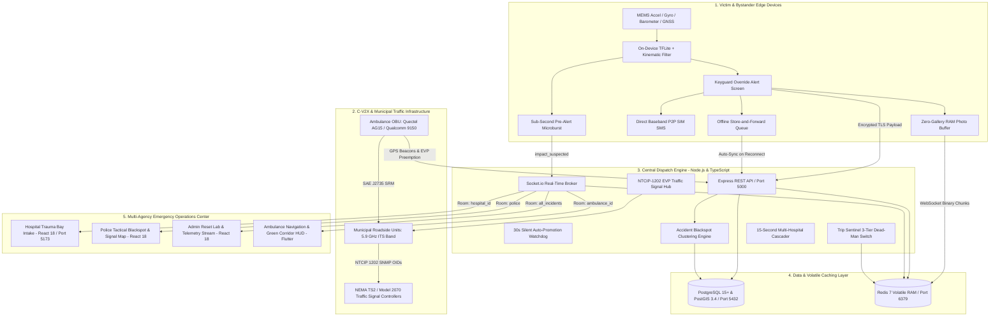

# Rakshak-AI System & Enterprise Architecture

> **Multi-Tier Autonomous Crash Intelligence, Real-Time Emergency Dispatch, PostGIS Spatial Triage & C-V2X Green Corridor Infrastructure**

---

## 🏛 Tier-by-Tier Architectural Breakdown

### 1. Mobile Edge & Sensor Fusion Layer (`/mobile`)
* **Hardware Sensing**: $50\text{ Hz}$ linear acceleration, angular rates, atmospheric barometric pressure transients, and high-precision GNSS positioning.
* **On-Device Inference**: TensorFlow Lite model (`crash_classifier.tflite`) paired with a rule-based kinematic fallback engine.
* **Pre-Alert Microburst**: Sub-second `impact_suspected` soft marker sent to police before the countdown completes.
* **Keyguard Bypass**: Android `USE_FULL_SCREEN_INTENT` + `showWhenLocked` waking the display over the PIN/biometric lock screen.
* **Zero-Gallery Camera**: Captures incident scenes directly into volatile memory buffers, bypassing persistent storage.
* **Native Baseband P2P SMS**: Direct SIM-to-SIM cellular dispatch over GSM/LTE radio, bypassing commercial cloud SMS gateways.
* **Offline Store-and-Forward**: RFC 4122 client UUID idempotency keys with exponential backoff synchronization.

### 2. Vehicle Telematics, C-V2X & Smart City IoT
* **Vehicle OBU Service**: Interfaces with in-vehicle telematics via USB-OTG serial, Bluetooth Low Energy (BLE 5.2), or native 3GPP Rel-16 C-V2X PC5 direct sidelink transceivers.
* **Emergency Vehicle Preemption (EVP)**: Broadcasts SAE J2735 Signal Request Messages (SRM) to municipal Roadside Units (RSU).
* **NTCIP 1202 Controller Interface**: Formats standard SNMP v2c/v3 OID commands (`1.3.6.1.4.1.1206.4.2.1.1.1` `ascPreemptControl`) to force green signal corridors for approaching ambulances.

### 3. Core Dispatch & Event Broker (`/backend`)
* **TypeScript & Node.js 20+ Runtime**: High-throughput asynchronous event processing.
* **Socket.io Multi-Agency Rooms**: Isolated namespaces and rooms (`hospital_{id}`, `police`, `ambulance_{id}`, `all_incidents`).
* **Silent Auto-Promotion Watchdog**: Promotes incidents to full emergency if the victim's phone loses power or breaks down upon impact.
* **Trip Sentinel Dead-Man Switch**: Monitors trip heartbeats with speed-before-silence sanity checks and short-TTL Redis storage.
* **Blackspot Cluster Engine**: PostGIS spatial queries identifying recurring accident blackspots in real time.
* **15-Second Multi-Hospital Escalation**: Cascades unaccepted emergency trauma cases across golden radius sectors.

### 4. Persistence & Volatile Storage Layer (`/db`)
* **PostgreSQL 15+ & PostGIS 3.4**: Spatial indexing (`geometry(Point, 4326)`, `ST_DWithin`, `ST_DistanceSphere`, GIST indexes) for hospital matching and accident clusters.
* **Volatile Redis 7**: Configured with zero disk persistence (`--save "" --appendonly no`) for volatile 10-minute image storage, ambulance beacons, and rate-limiting.

### 5. Multi-Agency Tactical Consoles (`/dashboard`)
* **Trauma Bay Intake Console (`/hospital`)**: Real-time crash cards, measured severity index, Ayushman Bharat (ABHA) medical profiles, and 1-click dispatch.
* **Police Command Map (`/police`)**: Tactical GIS map displaying active incidents, cruiser GPS locations, blackspot clusters, and manual traffic signal overrides.
* **Admin Reset Lab (`/admin`)**: System telemetry monitor, crash injectors, and 1-click clean slate purge engine.
